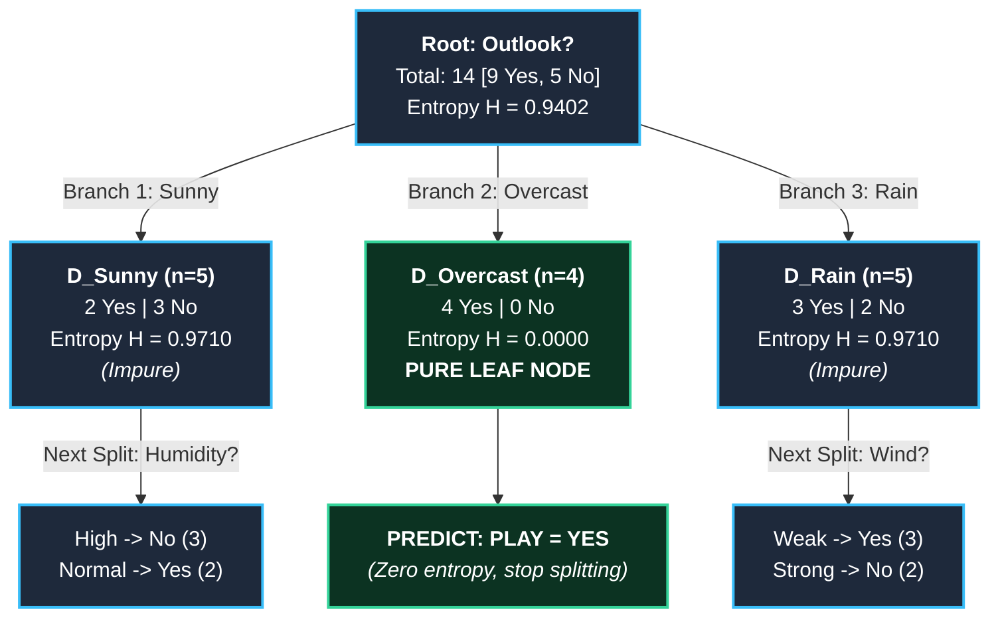

# Machine_Learning

## ML- 1 Intro

## ML-2

#### Formulas:

#### Hypothesis: h⊖(x) = ⊖0 + ⊖1x

## ML-4

## Independent and Dependent Features

### X = df[['Weight]] -> Independent features should be data frame or 2 dimensional array

### Y = df['Height'] -> This variable can be in series or 1D array

## ML-5

## Formula Y = (MX + C)

#### Y -> Predicted Value or Answer

#### M -> Intercept

#### X -> Input value of X

#### C -> Coefficient or Slope

# R Square

### Formula

#### R^2 = 1 - SSR/SST

#### R^2 = Coefficient of determination SSR = Sum of squares of residuals SST = Total sum of squares

## Adjusted R2 = 1 - [(1-R2)*(n-1)/(n-k-1)]

#### Where:

        R2: The R2 of the model
        n: The number of Observations
        k: The number of predictor Variables

### OLS Linear Regression

##### Importing Statsmodels

## ML-7

#### Logistic Regression

#### Logistic regression is a machine learning algorithm used for classification problems (Yes/No, 0/1)

#### Why not linear regression?

#### If we use linear regression for classification:

#### Output can be <0 or >1

#### But probability must be between 0 and 1

### Probability:

#### Probability is a concept in statistics that tells us how likely and event is to happen

## Formula:

    P(A) = Number of favorable outcomes / Total number of outcomes

## You toss a coin

#### Total outcome = 2 -> (Head, Tail)

#### probability of head = 1/2 = 0.5

## Roll a dice:

#### Total outcome = 6 -> (1,2,3,4,5,6)

#### probability of getting 3 = 1/6 = 0.167

## Probability value is always between number 0 and 1

#### 0 -> impossible event

#### 1 -> certain event

#### Between 0 and 1 -> possible event

## Odds (in Probability)

#### Odds tell us how likely and event will happen compared to it not happening

#### Odds = Favorable outcomes / Unfavorable outcomes

#### Odds in Favor of A = P(A)/1-P(A)

## Odds(heads) = p(heads)/p(not heads)

## Numerator

#### p(heads) = heads/heads+tails = 1/2

## Denominator

#### p(not heads) = p(tails) = tails/heads+tails = 1/2

#### (1/2)/(1/2)

#### 0.5/0.5

#### 1/1 or 1:1

## Odds (getting 1 while rolling 6 sided dices) = p(getting 1 while rolling dices)/p(not getting 1 while rolling dices)

#### P (getting 1 while rolling 6 sided dices) = 1 / 1,2,3,4,5,6 = 1/6

#### P (not getting one while rolling 6 sided dices) = 2,3,4,5,6, / 1,2,3,4,5,6 = 1/6

#### = (1/6)/(5/6)

#### =1/6 or 1:5

## Log odds

#### Log Odds means taking the algorithm of the odds.

#### it is widely used in statistics and machine learning (Especially Logistic regression)

## Formula

    Log Odds = log(P/1-P)

## Odds Ratio (OR)

#### Odds Ratio is used to compare two odds.

#### It tells how much more likely one event is compared to another

## ML 8 - 11

### Confusion Matrix

For Binary Classification

| Table           | Predicted Positive | Predicted Negative |
| --------------- | ------------------ | ------------------ |
| Actual Positive | TP(True Positive)  | FN(False Negative) |
| Actual Negative | FN(False Positive) | TN(True Negative)  |

Primary Building block:

- TP -> Correctly predicted positive
- TN -> Correctly predicted Negative
- FP -> Predicted positive but actually negative
- FN -> Predicted negative but actually positive

# Regression vs classification model evaluation

| Aspect      | Classification Model Evaluation | Regression Model Evaluation |
| ----------- | ------------------------------- | --------------------------- |
| Output Type | Predicts categories/classes     | predicts continuous Values  |
| Example     | Spam/ Not Spam                  | House Price Prediction      |

| Metric    | Classification | Regression |
| --------- | -------------- | ---------- |
| Accuracy  | Yes            | No         |
| Precision | Yes            | No         |
| Recall    | Yes            | No         |
| F1 Score  | Yes            | No         |
| MAE       | No             | Yes        |
| MSE       | No             | Yes        |
| RMSE      | No             | Yes        |

# Comparison Table between Balanced and imbalanced dataset

| Aspect               | Balanced Dataset                  | Imbalanced dataset              |
| -------------------- | --------------------------------- | ------------------------------- |
| Class distribution   | Classes have nearly equal samples | One class has many more samples |
| Example Ratio        | 50%:50%                           | 95% : 5%                        |
| Model Training       | Learns both classes fairly        | May ignore minority class       |
| Accuracy Reliability | Usually meaningful                | Can be misleading               |
| Metric Focus         | Accuracy can work                 | Precision/Recall/F1 Preferred   |
| Common Issue         | Less bias                         | Majority-class Bias             |

### Balanced Dataset have 50:50 of sample and original data values

### Imbalanced Dataset have 90:10 of sample and original data values

# Accuracy = Correct prediction / Total prediction (OR)

## Accuracy = (TP+TN) / (TP+TN+FP+FN)

#### Use accuracy Matrix to evaluate classification model only when there is balanced data.

#### When there is imbalance data don't use accuracy to evaluate classification model instead using Precision & recall

# Precision:

    Precision measures how many of the predicted positive cases where actually positive
    Precision = TP / TP+FP

# Recall

### Recall is an evaluation metric used in Logistic Regression (and other classification models) to measure how well the model identifies actual positive cases

### Recall is only 40%, meaning the model misses 60% of actual COVID Patients

### High accuracy does not guarantee high recall in imbalance datasets

### Trade Off - Precision and Recall have a trade-off because improving one often reduces the other

| If you                  | Precision |    Recall |
| :---------------------- | :-------: | --------: |
| Make model more strict  | Increases | Decreases |
| Make model more lenient | Decreases | Increases |

## Threshold - It controls the balance between precision and recall

# F-beta Score in Classification

    * summarise both recall and precision in single value
    * that common types of error in classification error
        * false positive - A negative case in predicted as positive
        * false negative - A positive case is predicted as negative

### a good model is that has good recall and good precision. Assume your model had recall 0.5 and Precision of 1.

### the average is 0.75

### 1 + 0.5 / 2 = 0.75 this is a good score but the model may not be because I recall of 0.5 is not very good

## F-beta Score formula

| Precisions | Recall | F-score |
| :--------- | :----: | ------: |
| High       |  High  |    High |
| Low        |  High  |     Low |
| High       |  Low   |     Low |

### Sensitivity - out of all actual positive cases how many date the model correctly identify

### Specificity - out of all actual negative cases how many did the model correctly identify

# 

# ROC Curve(Receiver Operating Characteristic Curve)

# The ROC Curve is used to evaluate how well a classification model separates two classes across different thresholds

The ROC curve plots:- X axis - False Positive rate(FPR) & Y axis - True Positive Rate (TPR / Sensitivity)

# 

# ML-11 Done

# ML-13

K Means:- the K means unsupervised learning algorithm and can be used Clustering

### Machine Learning Data is mainly 2 types:

#### 1. Labeled Data

#### 2. Unlabeled Data

#### 1. Labeled Data

##### Labeled Data means the data already has the correct answer (Output) - Input + Output

#### 2. Unlabeled Data

##### Unlabeled Data means the data only has only input, but no correct answer. (Input only)

## K usually means the number of groups/ neighbours / folds depending on the algorithm. and also find the clusters

#### 1. Labeled Data

| Age | Salary | Buy Product |
| :-- | :----: | ----------: |
| 22  | 25000  |          No |
| 35  | 50000  |         Yes |
| 28  | 35000  |          No |

#### 1. Age, Salary = Input

#### 2. Buy product = Output

#### 1. Unlabeled Data

| Age | Salary | Buy Product |
| :-- | :----: | ----------: |
| 22  | 25000  |          No |
| 35  | 50000  |         Yes |
| 28  | 35000  |          No |

- We have only the Data
- No Output/ no label/ no answer

## Centroid-Based Clustering

### Cluster is a group of similar data points

### Centroid in Machine learning - A Centroid is the center point of a cluster

1. Choose K and initialize centroids
   - First choose K = numbers of clusters
   - Here, K = 3
   - So the algorithm creates 3 centroids
   - These centroids are placed randomly at first

2. Assign Each point to the nearest centroid
   - Each data point checks which centroid is closest
   - Then it joins the centroid's cluster

3. Recalculate centroids
   - After assigning points,
   - The algorithm computers a new centre of each cluster

This new centre is the mean (average) of all points in that cluster

## Formula for Centroid = Sum of all points in cluster/ Number of points

Reassign points

- since centroid moved,
- some points Mainu be closer to a different centroid

Recalculate centroid again

- after reasining points
- centroid and recalculated again

Repeat until convergence
This process repeats:

- assign points
- recalculate centroid
- reassign points
- recalculate again

stopping condition in K means

1. Centroids stop moving

- K-Means stops when centroids no longer change position
- This means clusters are stable

Maximum number of iterations has been reached \* K-means does not run forever
We set a fixed limit such as:
10 iterations
50 iterations
100 iterations

If that maximum limit is reached the algorithm stops

2. Within cluster sum of squares is below a threshold
   This means the error inside cluster become very small.
   K-Means reduce the distance between:
   _ data points
   _ and their centroid

3. Convergence:-

- Convergence means the clusters stop changing
- points stay in the same cluster
- Points are no longer switching groups
- Red points stay red
- Blue points table blue
- Green points stay green
  So the grouping becomes stable

4. Stability

- Stability means centroid stop changing
- Centroids of new clusters do not change
- After recalculation the centroid remains in the same position

## \* Data points are clusters

## \* Mean value of Data points are centroid

## ML-13 Completed

# ML-14 Started

## KNN

    K-Nearest Neighbors (KNN) is a simple and versatile machine learning algorithm used for both classification and regression tasks. In this guide, I'll provide a comprehensive overview of KNN, covering its principles, implementation, strengths, weaknesses, and best practices.

1. Introduction to KNN:
   KNN is a non-parametric, lazy learning algorithm that classifies an unknown data point based on its similarity to known data points.
   It assumes that similar things exist in close proximity.

2. How KNN Works:
   For a given data point, KNN finds the k-nearest neighbors in the training set.
   Classification: A majority vote among the neighbors determines the class.
   Regression: The average of the neighbors' values predicts the target.

3. Choosing the Value of K:
   Experiment with different values of k.
   Consider odd values for binary classification.
   Utilize cross-validation, elbow method, and grid search to find the optimal k.

4. Distance Metrics:
   Common distance metrics include Euclidean distance, Manhattan distance, and Minkowski distance.
   Choose a distance metric based on the nature of the data.

5. Normalization:
   Normalize features to prevent attributes with larger scales from dominating the distance calculation.

6. Pros of KNN:
   Simple and easy to understand.
   No training phase; the algorithm is instance-based.
   Effective for smaller datasets and non-linear relationships.

7. Cons of KNN:
   Computationally expensive for large datasets.
   Sensitive to irrelevant features.
   Requires sufficient training data to perform well.

8. Use Cases:
   Image and speech recognition.
   Recommender systems.
   Anomaly detection.
   Medical diagnosis.

9. Implementation Steps:
   Load and preprocess the dataset.
   Split the dataset into training and testing sets.
   Choose a distance metric and normalize features if needed.
   Train the KNN model on the training set.
   Evaluate the model on the testing set.

10. Best Practices:
    Choose an appropriate distance metric.
    Handle ties appropriately (e.g., by choosing an odd k for binary classification).
    Consider the impact of outliers.
    KNN is a versatile algorithm suitable for various tasks.
    Its performance depends on proper parameter tuning and appropriate data preprocessing.
    Experiment with different configurations to find the optimal KNN model for your specific problem.

11. Example Code (Python - scikit-learn):
    from sklearn.neighbors import KNeighborsClassifier
    from sklearn.model_selection import train_test_split
    from sklearn.metrics import accuracy_score

# Load and preprocess data

X_train, X_test, y_train, y_test = train_test_split(features, labels, test_size=0.2)

# Create KNN classifier

knn = KNeighborsClassifier(n_neighbors=3)

# Train the model

knn.fit(X_train, y_train)

# Make predictions

predictions = knn.predict(X_test)

# Evaluate accuracy

accuracy = accuracy_score(y_test, predictions)
print(f"Accuracy: {accuracy}")

# ML-14 Completed

# ML-15 Started

# Decision Tree

#### Decision tree is a popular model in machine learning used for classification and regression task.

#### It works like a flowchart where each internal note represents the decision based on feature, each branch represent the outcome of the decision and each leave note represents A final prediction

#### Decision tree classifier:

#### Algorithms:

##### 1. ID 3

##### 2. CART

## Multi Way Split explanation

# Decision Trees: Multiway Split (K-ary Split)

A **Multiway Split** (also referred to as a **K-ary Split**) is a decision tree branching strategy where a single decision node divides into **$k$ distinct child branches simultaneously**, corresponding to the $k$ distinct categorical values of the splitting attribute.

Below is the complete architectural diagram and infographic generated for this concept:

---

## 1. What is a Multiway Split?

In algorithms like **ID3**, **C4.5**, and **CHAID**:

- When a categorical feature $A$ is selected for splitting at node $N$, the algorithm creates one child branch for **every possible discrete value** $v \in \text{Domain}(A)$.
- Given dataset $D$ at node $N$ and attribute $A = \{v_1, v_2, \dots, v_k\}$:
  $$D_j = \{ x \in D \mid x.A = v_j \}, \quad \text{for } j = 1, 2, \dots, k$$
- The partition is exhaustive and mutually exclusive:
  $$D = \bigcup_{j=1}^k D_j \quad \text{and} \quad D_i \cap D_j = \emptyset \ (i \neq j)$$

### Multiway Split vs. Binary Split (CART)

| Characteristic           | Multiway Split (ID3 / C4.5 / CHAID)                       | Binary Split (CART / scikit-learn)                       |
| :----------------------- | :-------------------------------------------------------- | :------------------------------------------------------- |
| **Branching Factor**     | $k$ branches ($k =$ number of discrete categories)        | Exactly 2 branches (`True` / `False`)                    |
| **Tree Geometry**        | Flatter, wider tree                                       | Deeper, narrower tree                                    |
| **Categorical Handling** | 1 branch per categorical value naturally                  | Requires subset partitioning ($A \in S$ vs $A \notin S$) |
| **Data Fragmentation**   | **High**: Data sample size drops quickly across $k$ nodes | **Low**: Samples divide into only 2 subsets per level    |
| **Continuous Features**  | Discretized into $k$ numeric intervals                    | Threshold split: $Feature \le \theta$                    |

---

## 2. Sample Weather Dataset (Play Tennis)

The standard benchmark dataset consists of 14 historical records with features `Outlook`, `Temperature`, `Humidity`, `Wind`, and target `Play Tennis?`:

|   Day   | Outlook  | Temperature | Humidity |  Wind  | Play Tennis? |
| :-----: | :------: | :---------: | :------: | :----: | :----------: |
| **D1**  |  Sunny   |     Hot     |   High   |  Weak  |    **No**    |
| **D2**  |  Sunny   |     Hot     |   High   | Strong |    **No**    |
| **D3**  | Overcast |     Hot     |   High   |  Weak  |   **Yes**    |
| **D4**  |   Rain   |    Mild     |   High   |  Weak  |   **Yes**    |
| **D5**  |   Rain   |    Cool     |  Normal  |  Weak  |   **Yes**    |
| **D6**  |   Rain   |    Cool     |  Normal  | Strong |    **No**    |
| **D7**  | Overcast |    Cool     |  Normal  | Strong |   **Yes**    |
| **D8**  |  Sunny   |    Mild     |   High   |  Weak  |    **No**    |
| **D9**  |  Sunny   |    Cool     |  Normal  |  Weak  |   **Yes**    |
| **D10** |   Rain   |    Mild     |  Normal  |  Weak  |   **Yes**    |
| **D11** |  Sunny   |    Mild     |  Normal  | Strong |   **Yes**    |
| **D12** | Overcast |    Mild     |   High   | Strong |   **Yes**    |
| **D13** | Overcast |     Hot     |  Normal  |  Weak  |   **Yes**    |
| **D14** |   Rain   |    Mild     |   High   | Strong |    **No**    |

- **Total records**: $|D| = 14$ ($9\text{ Yes}, 5\text{ No}$)
- **Splitting Feature**: `Outlook` has $k = 3$ discrete values: `{Sunny, Overcast, Rain}`.

---

## 3. Tree Split Structure on `Outlook`

1. **`Outlook == 'Overcast'` (Pure Leaf)**:
   - Contains 4 samples (D3, D7, D12, D13), all 4 are `Yes`.
   - Entropy drops to $0.0000$. Splitting stops immediately, and the node outputs prediction **`Play = Yes`**.
2. **`Outlook == 'Sunny'`**:
   - Contains 5 samples (D1, D2, D8, D9, D11): 2 `Yes`, 3 `No`.
   - Impure ($H = 0.9710$). Needs a secondary split on `Humidity` (`High` $\to$ No, `Normal` $\to$ Yes).
3. **`Outlook == 'Rain'`**:
   - Contains 5 samples (D4, D5, D6, D10, D14): 3 `Yes`, 2 `No`.
   - Impure ($H = 0.9710$). Needs a secondary split on `Wind` (`Weak` $\to$ Yes, `Strong` $\to$ No).

---

## 4. Mathematical Derivation (Entropy & Information Gain)

### Step 1: Root Shannon Entropy

$$H(D) = - \sum_{i=1}^C p_i \log_2(p_i) = - \left[ \frac{9}{14} \log_2 \left(\frac{9}{14}\right) + \frac{5}{14} \log_2 \left(\frac{5}{14}\right) \right] = 0.9402 \text{ bits}$$

### Step 2: Child Node Entropies

- **Sunny ($n = 5$, 2 Yes, 3 No)**:
  $$H(D_{\text{Sunny}}) = - \left[ \frac{2}{5} \log_2 \left(\frac{2}{5}\right) + \frac{3}{5} \log_2 \left(\frac{3}{5}\right) \right] = 0.9710 \text{ bits}$$
- **Overcast ($n = 4$, 4 Yes, 0 No)**:
  $$H(D_{\text{Overcast}}) = - \left[ \frac{4}{4} \log_2 \left(\frac{4}{4}\right) + 0 \right] = 0.0000 \text{ bits} \quad (\text{Pure})$$
- **Rain ($n = 5$, 3 Yes, 2 No)**:
  $$H(D_{\text{Rain}}) = - \left[ \frac{3}{5} \log_2 \left(\frac{3}{5}\right) + \frac{2}{5} \log_2 \left(\frac{2}{5}\right) \right] = 0.9710 \text{ bits}$$

### Step 3: Weighted Expected Entropy After Multiway Split

$$H(D \mid \text{Outlook}) = \sum_{v \in \{\text{Sunny}, \text{Overcast}, \text{Rain}\}} \frac{|D_v|}{|D|} H(D_v)$$
$$H(D \mid \text{Outlook}) = \frac{5}{14}(0.9710) + \frac{4}{14}(0.0000) + \frac{5}{14}(0.9710) = 0.6936 \text{ bits}$$

### Step 4: Information Gain Calculation

$$IG(D, \text{Outlook}) = H(D) - H(D \mid \text{Outlook}) = 0.9402 - 0.6936 = \mathbf{0.2466 \text{ bits}}$$

### Step 5: Attribute Comparison

Comparing Information Gain across all candidate attributes demonstrates why `Outlook` is selected as the root node:

- **`IG(D, Outlook) = 0.2466`** $\leftarrow$ **Highest Gain**
- `IG(D, Humidity) = 0.1518`
- `IG(D, Wind) = 0.0481`
- `IG(D, Temperature) = 0.0289`

---

## 5. Strengths & Limitations

> [!TIP]
> **Advantages of Multiway Split**:
>
> - Directly represents nominal data without arbitrary binary groupings or dummy encoding.
> - Produces concise, shallow trees that closely follow domain logic.

> [!WARNING]
> **Data Fragmentation & High-Cardinality Bias**:
>
> - **Data Starvation**: Splitting samples $k$ ways at every step can leave very few training instances in deeper child nodes.
> - **Bias towards high-cardinality attributes**: Features with many unique values (like `Customer_ID` or `Date`) trivially achieve $H = 0$ at child nodes.
> - **Solution**: C4.5 addresses this by normalizing Information Gain using **Split Information** to compute the **Gain Ratio**:
>   $$\text{GainRatio}(D, A) = \frac{IG(D, A)}{\text{SplitInfo}(D, A)}, \quad \text{where } \text{SplitInfo}(D, A) = - \sum_{j=1}^k \frac{|D_j|}{|D|} \log_2 \left( \frac{|D_j|}{|D|} \right)$$

# ML - 16 Started

## Decision Tree

#### If I have large dataset with more columns

#### If you use Entropy or Gini and still do not find a node/split in your decision tree, usually on of these reasons is happening

## Gini

#### Symbol - Meaning

#### ∑ - Summation (Add all values)

#### p(i) - Probability of each class

#### p(i)^2 - Square of Probability

#### 1 - Substract from 1

# ML - 17 Started

## Information Gain

### Information Gain is used in a decision Tree to find:

### Which attribute gives the best split

### Formula

#### Information Gain = Parent Entropy - Weighted Child Entropy

## When to use Entropy Vs Gini

### Done

# ML - 18 Done with once car prediction program

# ML - 19 Done with once car prediction program

# ML - 20 Done with once car prediction program

# ML - 21 Done with once car prediction program

# 1e5 => (1*10)^5 = 1*10*10*10*10*10 = 100000

# 1e4 => (1*10)^4 = 1*10*10*10\*10 = 10000

# 1e3 => (1*10)^3 = 1*10*10*10 = 1000

# 1e2 => (1*10)^2 = 1*10\*10 = 100

# ML - 22 Done with once car prediction program and Done

# ML - 23 Done with once car prediction program with Decision Tree and Done

# ML - 24 Done with Loan prediction program and Done

# ML - 25 Done with Loan prediction program and Done

# ML - 26 Started with Random Forest and Done

# ML - 27 Started with Random Forest and Done
